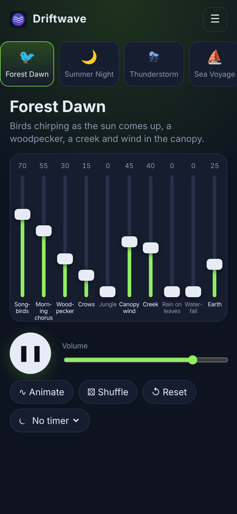

# Driftwave



**A free ambient sound mixer that works completely offline, on Windows, Mac, Linux, Android and in the browser.**

Mix rain, forest birdsong, ocean waves, a crackling fireplace, a café, white/pink/brown noise and more,
each soundscape with 10 sliders you can blend to taste. Use it to:

- **Fall asleep** or stay asleep, with a sleep timer that gently fades out
- **Focus** while studying or working, by masking chatter, traffic and office noise
- **Relax**, meditate or calm a busy mind
- **Soothe babies and pets**, or drown out snoring and noisy neighbours

No account, no ads, no tracking, no internet needed. Everything runs on your own device.

## ⬇ Download

| Platform | File | How |
|---|---|---|
| **Windows** | [Driftwave-PC.zip](downloads/Driftwave-PC.zip) | Unzip, then double-click **Install Driftwave (Windows).bat**. It adds Driftwave to your Start menu and desktop. |
| **Mac / Linux** | [Driftwave-PC.zip](downloads/Driftwave-PC.zip) | Unzip, then double-click **Start Driftwave (Mac).command** or run `start-driftwave-linux.sh`. |
| **Android** | [Driftwave-1.2-debug.apk](downloads/Driftwave-1.2-debug.apk) | Open on your phone and allow "Install unknown apps". |
| **Any browser** | [driftwave-offline.html](downloads/driftwave-offline.html) | Just open it. Single file, synthesized soundscapes only. |

The same files are attached to the latest [Release](../../releases/latest). On a file's page, use the
**Download raw file** (↓) button.

## What's inside

**16 soundscapes × 10 layers.** Every layer has its own slider.

| Synthesized live (no audio files) | Real field recordings |
|---|---|
| Spectrum: a 10-band noise equaliser | Forest Dawn: songbirds, woodpecker, creek |
| Rainfall | Summer Night: crickets, frogs, owl, campfire |
| Shoreline | Thunderstorm: rain on windows, tents, leaves; thunder |
| Hearth (fireplace) | Sea Voyage: waves, gulls, sailboat, whales |
| Woodland | Café Corner: chatter, typing, pages, vinyl |
| Brook | Countryside: hens, cows, sheep, bees |
| Night Flight (cabin hum) | Cozy Home: fireplace, purring cat, dryer, chimes |
| Deep Space (drones) | On the Move: train, airplane, car in the rain |

**Features:** master volume, **Animate** (layers drift slowly so the sound never feels static),
**Shuffle**, **Reset**, sleep timer with fade-out, saved presets, lock-screen media controls, and on
Android, background playback with the screen off.

## For developers

### Ways to run it

| Option | How |
|---|---|
| Single file (simplest) | Open `downloads/driftwave-offline.html` in any modern browser. No server needed. (Synth soundscapes only, since browsers block loading the sound files from disk.) |
| PC (full version) | Unzip `downloads/Driftwave-PC.zip`. Windows: run `Install Driftwave (Windows).bat` for Start menu/desktop shortcuts. Mac/Linux: double-click the launcher. Rebuild it with `npm run pc`. |
| Installable web app (PWA) | `npm run serve` → open http://localhost:8080, then "Install app". After the first load it works offline. |
| Android APK | Install `downloads/Driftwave-1.2-debug.apk` on your phone (allow "install unknown apps"). |

### Project layout

```
www/                 the app (HTML/CSS/JS) — this is the source of truth
  js/engine.js       audio synthesis engine
  js/scapes.js       soundscape + layer definitions  ← add your own here
  js/calib.js        auto-generated loudness calibration
  js/app.js          UI logic
  sw.js              service worker (offline cache for the PWA)
android/             Capacitor Android project (native wrapper)
  app/src/main/java/com/driftwave/noise/PlaybackService.java  keeps audio playing with screen off
tools/build-single.py  bundles www/ into dist/driftwave-offline.html
```

### Rebuilding the APK

Requirements: Node 18+, JDK 21, Android SDK (platform 36, build-tools). Then:

```bash
npm install
npm run android:apk        # → android/app/build/outputs/apk/debug/app-debug.apk
```

Or open the `android/` folder in Android Studio and press Run.

For a Play-Store/release build, create a keystore and run `./gradlew assembleRelease`
(or `bundleRelease`) with signing configured in `android/app/build.gradle`.

### Adding a soundscape

Add an entry to `SCAPES` in `www/js/scapes.js`. Each layer chooses a source
(`white`/`pink`/`brown` noise, an event texture like `ev:drops`, or `osc: [freqs]`),
optional filters, panning and slow modulation. If you add layers, re-run the loudness
calibration (`node tools/calibrate/calibrate.js`, needs Playwright) or just tune each layer's `level`.

## Sound credits & licenses

The **code** is released under the [MIT License](LICENSE).

The **recordings** in `www/sounds/` keep their own licenses. They come from two open-source projects:
[Blanket](https://github.com/rafaelmardojai/blanket) (CC0, public domain or CC BY; each one is credited in
`www/js/credits.js` and in the app under ☰ → *Sound credits*) and [Moodist](https://github.com/remvze/moodist)
(CC0 or the [Pixabay Content License](https://pixabay.com/service/license-summary/)). The files are
trimmed, looped and loudness-matched. They're stored as `.txt` (Ogg Opus data inside) so download managers
such as IDM don't intercept them. To regenerate them from the source repos:
`python3 tools/prepare-sounds.py <moodist>/public/sounds <blanket>/data/resources/sounds` (needs ffmpeg + numpy).

The synthesized soundscapes are original.
